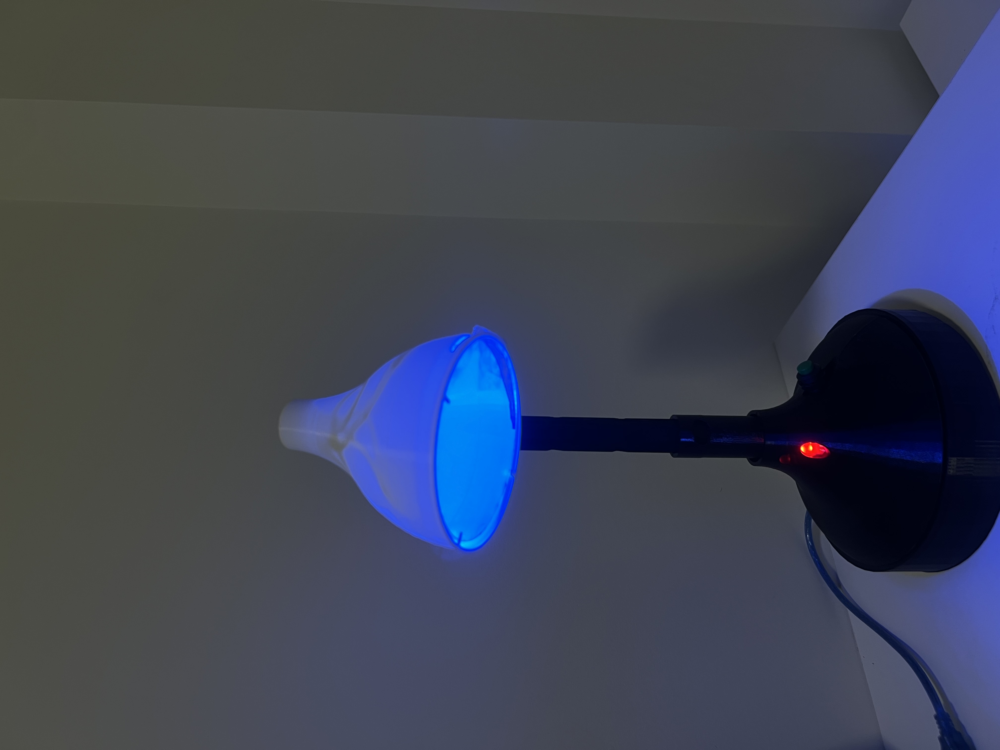

# MARIDA Smart Lamp (Design Day 2024, 1st of 25 teams)

An Arduino-based lamp that adjusts its brightness to the ambient light and flags sustained noise. Team project (5 members) for Design Day at the University of Ottawa, November 2024. I led the team.

## What it does

- **Ambient light:** reads a KY-018 light sensor (A0) and drives a white LED (PWM, D9) inversely: the darker the room, the brighter the lamp (brightness mapped from 255 down to 10).
- **Noise alert:** reads a KY-037 sound sensor (A1). If the level stays above the threshold (1010 on the 0–1023 ADC scale) for 15 seconds, a red LED (D8) turns on. It turns off after 10 seconds without noise.
- **Timing:** the loop runs every 100 ms (about 10 Hz). Serial output at 9600 baud prints the sensor values for debugging.

## Hardware

- Board: Arduino Uno
- KY-018 light sensor, KY-037 sound sensor
- White LED (PWM) and red LED, with 1 Kohm and two 220 ohms resistors 
- Enclosure: 3D-printed

## Design decisions

- The alert needs **sustained** noise, so a single loud sound does not trigger it. The 10-second cooldown keeps it from flickering on and off.
- Timing uses `millis()` instead of long delays, so the alert logic does not block the light control.

## Known limitations

- The noise threshold is hard-coded and was chosen for our sensor and room.
- Sensor readings are not filtered, so one quiet sample resets the 15-second timer.
- The loop still uses a short `delay(100)`.

**Ideas to improve:** average the readings (moving average), calibrate the threshold at startup, and measure the response time.

## My role

Team lead, and the only Electrical Engineering student on the team of 5. I was in charge of the coding (the Arduino firmware) and the wiring and circuit. The team tested the sensors together, and I was responsible for that testing. I also took part in designing the lamp.

## Result

1st place out of 25 teams at Design Day, University of Ottawa, November 2024.

## Files

- `code_projet.ino`: the Arduino firmware (the lamp code)
- `smart_lamp1.jpeg`: photo of the lamp
- `demo_smart_lamp.MOV` : behaviour of the lamp in a noisy environment 
